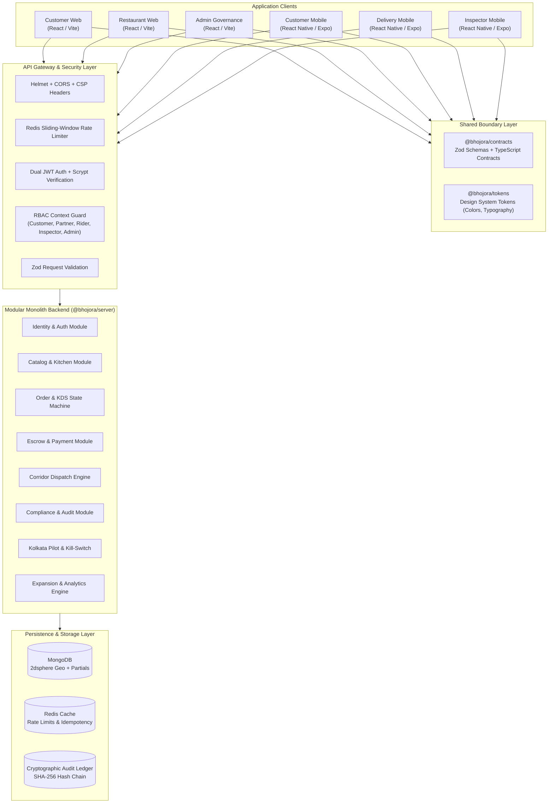
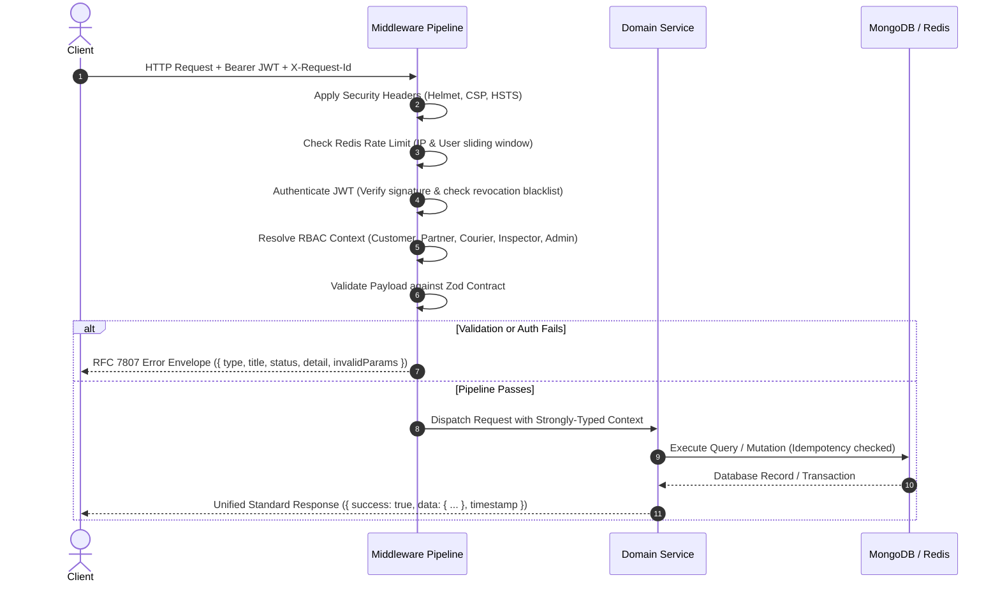

# BHOJORA — Food You Love. Trust You Deserve.

> **Kolkata's Independent Food Discovery & Verified Kitchen Trust Platform**  
> An ethical, transparent, and hygiene-certified food delivery ecosystem connecting conscious diners, culinary kitchens, delivery partners, and accredited food safety inspectors.

[](https://github.com/Soumyaroy428/BHOJORA)
[](docs/01-CORE-PLANNING-DESIGN/ARCHITECTURE.md)
[](tsconfig.base.json)
[](docs/03-SECURITY-QUALITY/THREAT_MODEL_AND_SECURITY_SIGN_OFF.md)
[](docs/03-SECURITY-QUALITY/LAUNCH_READINESS_DOSSIER.md)

---

## 1. Executive Overview

In the modern urban food landscape, standard food delivery platforms have prioritized hyper-growth over diner health and merchant sustainability. Diners routinely order from uninspected "ghost kitchens" with no visibility into kitchen hygiene, while facing hidden "platform fees", rain surges, and marked-up menu prices. Simultaneously, restaurant margins are decimated by 30%+ aggregator commissions, and delivery riders navigate arbitrary payouts with ambiguous tip deductions.

**BHOJORA** changes this equation. We fuse on-demand culinary convenience with an **independent, physical kitchen verification and trust transparency engine**. Every participating restaurant is physically audited across water purity, food handling, cold storage integrity, and kitchen sanitation before earning a public, tamper-evident safety rating.

---

## 2. Why BHOJORA is Different from Zomato and Swiggy

| Dimension                            | Typical Aggregators (Zomato / Swiggy)                                                                                                                                      | BHOJORA Trust Platform                                                                                                                                                                         |
| ------------------------------------ | -------------------------------------------------------------------------------------------------------------------------------------------------------------------------- | ---------------------------------------------------------------------------------------------------------------------------------------------------------------------------------------------- |
| **Kitchen Food Safety**              | Self-declared FSSAI number (often outdated/unverified). No public kitchen photos or sanitation audits. Unverified dark/cloud kitchens proliferate freely.                  | **Physical, on-site audits** conducted by accredited food safety inspectors. Objective 100-point hygiene rating, audit date, and prep area photos published directly on every restaurant card. |
| **Pricing & Fee Transparency**       | **Drip pricing & hidden fees:** Arbitrary "platform fees" (₹6–₹10), delivery fees, packaging fees, and dynamic rain/peak surge charges added at the final checkout screen. | **Zero platform fees & zero drip pricing.** Complete upfront bill breakdown with no surprise checkout charges. Delivery charges are strictly distance-based and transparently displayed.       |
| **Menu Pricing Parity**              | Menu prices are typically inflated by 20%–40% over dine-in rates to compensate for heavy platform commissions.                                                             | **Strict price parity guarantee.** Menu items reflect true outlet pricing with verified single-outlet cart billing.                                                                            |
| **Restaurant Commissions**           | Aggressive **25% to 35%+ platform commission**, plus forced discount schemes that severely erode kitchen profitability.                                                    | **Sustainable 16.5% flat take rate**, with zero mandatory discounting mandates, enabling restaurants to focus on ingredient quality.                                                           |
| **Search & Discovery Ethics**        | Algorithmic ranking heavily favors restaurants that pay for "promoted" ads and sponsored keyword bidding over kitchen quality.                                             | **Ethical meritocracy.** Ranking is determined purely by verified hygiene rating, culinary specialization, consumer reviews, and physical proximity. Paid placement is prohibited.             |
| **Delivery Radius & Food Freshness** | Multi-order batching across long 12–15 km delivery radiuses, resulting in soggy, lukewarm food delivered after 60+ minutes.                                                | **Strict 5.5–6.0 km corridor bounds.** Hot-chain food integrity is preserved with single-outlet delivery focus, guaranteeing fresh delivery within 25–35 minutes.                              |
| **Delivery Rider Welfare**           | Fluctuating delivery incentives, opaque tip pools, and lack of shift accident protection.                                                                                  | **Guaranteed distance-based floor pay, 100% direct customer tip pass-through** (zero platform cut), and active Group Personal Accident insurance on every shift.                               |
| **Data Privacy & User Rights**       | Pervasive cross-app ad tracking, profiling, and permanent telemetry storage.                                                                                               | **Built for India's DPDP Act 2023.** Granular consent management, automated PII export, self-service Right to Erasure, and automated 30-day GPS telemetry purge.                               |

---

## 3. End-to-End User Journeys (How BHOJORA Works for Users)

Bhojora coordinates four distinct user personas across four synchronized journeys:

```
+----------------------------------------------------------------------------------------------------+
|                                    BHOJORA PLATFORM ECOSYSTEM                                      |
+----------------------------------------------------------------------------------------------------+
|  1. Conscious Diners      --> Browse verified kitchens, inspect hygiene, order at true prices     |
|  2. Kitchen Partners      --> Receive live orders on KDS, seal tamper-proof packaging, track T+1   |
|  3. Delivery Couriers     --> Single-order corridor transit, OTP handoff, direct tip payout        |
|  4. Safety Inspectors     --> Unannounced physical audits, SHA-256 evidence, dual sign-off checks |
+----------------------------------------------------------------------------------------------------+
```

### 3.1. Diner Journey (Conscious Consumer Experience)

1. **Corridor Discovery & Zone Filtering:**
   - Diners select their localized corridor (e.g., Salt Lake Sector V or Park Street / Bhowanipore).
   - The platform strictly enforces a **5.5–6.0 km delivery boundary** to guarantee hot-chain food integrity and delivery in under 35 minutes.
   - Filter restaurants by dietary preferences (Vegetarian, Non-Vegetarian, Jain, Vegan, Halal) and minimum hygiene threshold (e.g., Hygiene Rating $\ge$ 90/100).
2. **Transparent Kitchen Inspection:**
   - Diners tap on any restaurant card to open its public **Kitchen Trust Dossier**.
   - Review recent inspection date, accredited inspector ID, pest-control certifications, water purity tests (TDS/bacterial analysis), and unedited kitchen preparation photos.
3. **Cart Building with True Dine-In Prices:**
   - Real-time stock validation ensures out-of-stock items cannot be added.
   - Single-outlet cart structure prevents multi-restaurant batching delays.
   - Menu prices exactly match the restaurant's in-person dine-in rates.
4. **Upfront Quote & Secure Checkout:**
   - Server computes an authoritative quote itemizing food subtotal, statutory restaurant GST (under Section 9(5) CGST Act), and distance-based delivery logistics.
   - **Zero platform fees, zero surge charges, and zero surprise packaging add-ons.**
   - Payments processed securely via tokenized UPI, net banking, or debit/credit cards.
5. **Real-time Preparation & Courier Tracking:**
   - Real-time WebSocket connection streams status updates: `PLACED` $\rightarrow$ `CONFIRMED` $\rightarrow$ `PREPARING` $\rightarrow$ `READY_FOR_PICKUP` $\rightarrow$ `OUT_FOR_DELIVERY`.
   - Diners observe courier location telemetry inside the bounded delivery zone.
6. **4-Digit Delivery OTP Handoff & Hygiene Feedback:**
   - Secure handoff requires the customer to provide a unique, single-use 4-digit OTP to the delivery courier.
   - Once verified, diners can rate both food quality and physical packaging seal condition.

---

### 3.2. Restaurant Partner Journey (Kitchen Operations)

1. **Onboarding & Physical Verification:**
   - Restaurant registers FSSAI (14 digits) and GSTIN (15 characters) licenses.
   - An accredited food safety auditor visits the facility to execute an unannounced 100-point inspection covering food storage, refrigeration temperature ($\le 4^\circ\text{C}$), water filtration, and worker health cards.
   - Minimum rating of 80/100 required for commercial listing.
2. **Menu Publishing & Stock Throttling:**
   - Kitchen managers publish menu catalogs with verified preparation times and allergy disclaimers.
   - Out-of-stock dishes can be toggled ("86-ed") instantly from the merchant portal.
   - Kitchens can temporarily throttle incoming orders during peak kitchen load to maintain quality standards.
3. **Live Kitchen Display System (KDS):**
   - Incoming orders trigger real-time visual and audible notifications.
   - Clear display of special cooking instructions, dietary badges, and target preparation countdown timers.
   - Kitchen clicks "Mark Ready" once food is packaged.
4. **Tamper-Evident Packaging & Courier Handover:**
   - Food is sealed inside tamper-evident containers with a serialized hygiene sticker.
   - Kitchen verifies the courier's badge and hands over the package.
5. **Settlement & Regulatory Accounting:**
   - Automated financial ledger remits net revenue on a **T+1 daily settlement schedule** at a flat **16.5% take rate**.
   - Clear GST reports automatically generated for Section 9(5) tax filings.

---

### 3.3. Delivery Partner Journey (Fleet Logistics & Welfare)

1. **Shift Check-in & Corridor Allocation:**
   - Couriers check in within their designated 5.5–6.0 km delivery zone.
   - Active status activates on-shift Group Personal Accident insurance.
2. **Dedicated Algorithmic Dispatch:**
   - Algorithmic dispatch assigns one dedicated order per courier based on proximity and kitchen prep readiness.
   - Zero multi-restaurant order stacking or cross-city 15 km routes.
3. **Merchant Pickup Verification:**
   - Courier navigates to the merchant, inspects the tamper-evident packaging seal, and confirms pickup.
4. **Calibrated Transit:**
   - Turn-by-turn routing utilizes safe speed models rather than unrealistic delivery promises that encourage dangerous driving.
   - Real-time GPS pings keep customer and merchant updated.
5. **Handoff Verification & Instant Earnings:**
   - Courier enters the customer's 4-digit OTP on the mobile app to validate completion.
   - Payout includes guaranteed distance-based base fare plus **100% of customer tips** remitted directly to the partner's account with zero platform commission.

---

### 3.4. Safety Inspector Journey (Independent Audit & Governance)

1. **Unannounced Field Audits:**
   - Accredited inspectors receive scheduled or surprise audit tasks on their offline-first mobile inspection app.
   - GPS geofencing confirms physical presence at the kitchen location.
2. **Standardized 100-Point Inspection Rubric:**
   - Evaluates: Water purity & ice storage (20 pts), Cold chain & raw meat segregation (25 pts), Cooking surface & utensil sanitation (25 pts), Food handler PPE & hygiene certification (15 pts), and Pest management (15 pts).
3. **Cryptographic Proof of Audit:**
   - High-resolution timestamped photos and swab test results are hashed with SHA-256 before upload, preventing retrospective modification.
4. **Separation-of-Duties Peer Verification:**
   - An independent compliance officer reviews and counter-signs the audit findings before the new rating is published on the customer app.
5. **Automated Enforcement:**
   - Any critical hazard (e.g., sewage leakage, pest infestation) immediately triggers an automated temporary listing suspension ($\le 15$ minutes) until re-inspection passes.

---

## 4. Developer Technical Workflow & System Architecture



### 4.1. Contract-First Monorepo Architecture

Bhojora enforces strict contract-first design. All API request/response payloads, domain models, and validation rules are defined in `client/shared/contracts/` using **Zod** and exported through TypeScript types:

```
client/shared/contracts/
├── auth.ts          # Login, Registration, OTP, Token rotation contracts
├── catalog.ts       # Restaurant, Menu, Item, and Category schemas
├── order.ts         # Cart, Price Quote, Checkout, and State transition schemas
├── audit.ts         # 100-point physical inspection schemas and hash verification
├── compliance.ts    # FSSAI, GSTIN, DPDP, and Statutory readiness schemas
├── pilot.ts         # Zone gating, invite cohort, and emergency kill-switch schemas
└── expansion.ts     # Unit economics, founder approval, and city expansion schemas
```

- **Zero API Drift:** The server middleware validates incoming HTTP bodies against the shared Zod schema (`validateBody(schema)`).
- **Client Type Safety:** Frontend applications import the exact inferred TypeScript interfaces (`z.infer<typeof Schema>`), guaranteeing end-to-end synchronization across web and mobile surfaces.

---

### 4.2. Request Lifecycle & Security Middleware Pipeline

Every HTTP request to `@bhojora/server` traverses an enterprise security pipeline before reaching domain business logic:



1. **Request Correlation (`requestIdMiddleware`):** Injects or extracts `X-Request-Id` for distributed traceability across structured Winston logs.
2. **Security Headers (`helmet`):** Strict Content Security Policy (CSP), HTTP Strict Transport Security (HSTS), X-Content-Type-Options, and frameguard protections.
3. **Sliding-Window Rate Limiting:** Enforced via Redis token bucket algorithm with IP and user tiering.
4. **Dual JWT Authentication & Revocation:** Access tokens (15-min life) verified via HMAC-SHA256; refresh tokens (7-day life) tracked with family rotation and instant revocation on reuse.
5. **RBAC Guard (`requireRole`):** Strictly gates sensitive endpoints (e.g., Inspector-only audit submission, Admin-only kill-switch, Partner-only KDS updates).
6. **Zod Validation Middleware (`validateBody`, `validateQuery`, `validateParams`):** Rejects invalid payloads before touching business logic, returning structured RFC 7807 error messages.
7. **Circuit Breaker Protection:** Protects external integrations (payment gateway, reverse geocoding, SMS gateways) with tri-state resilience (`CLOSED`, `OPEN`, `HALF_OPEN`).

---

### 4.3. Domain Module Structure

The backend server is structured as an enterprise modular monolith in `server/src/modules/`:

```
server/src/modules/
├── identity/       # scrypt hashing, JWT generation, user & role stores
├── catalog/        # Kitchen profiles, menu hierarchy, 2dsphere proximity search
├── order/          # Quote calculation, state machine, single-outlet cart
├── dispatch/       # Corridor matching, rider assignment, Haversine fallback
├── inspection/     # 100-point rubric evaluation, photo hash verification
├── compliance/     # Statutory checks, FSSAI/GSTIN validation, adviser dossiers
├── pilot/          # Zone-gated operations, cohort invites, emergency kill-switch
├── expansion/      # Unit economics, founder approval signatures, multi-city plans
├── performance/    # Memory telemetry, load drill harness, disaster recovery drills
└── privacy/        # DPDP data access exports, right-to-erasure anonymization
```

Each module encapsulates its own:

- `*.types.ts`: Internal domain types and service contracts.
- `*.store.ts`: Database persistence layer (MongoDB models and in-memory test fallback).
- `*.service.ts`: Pure business logic, transaction handling, and domain event publishing.
- `*.routes.ts`: Express router definitions with role guards and input validators.

---

### 4.4. Developer Day-to-Day Workflow

#### 1. Repository Setup & Clean Dependency Installation

```bash
# Clone the repository
git clone https://github.com/Soumyaroy428/BHOJORA.git
cd BHOJORA

# Install locked dependencies across all monorepo workspaces
npm ci
```

#### 2. Local Environment Configuration

```bash
# Copy example environment configuration
cp server/.env.example server/.env

# Default development configuration uses local MongoDB & Redis:
# PORT=4000
# MONGO_URI=mongodb://localhost:27017/bhojora
# REDIS_URL=redis://localhost:6379
# JWT_SECRET=bhojora-dev-jwt-secret-min-32-chars-long
```

#### 3. Running Code Quality & Static Analysis Checks

```bash
# Verify code formatting (Prettier)
npm run format:check

# Fix auto-formattable code style issues
npm run format

# Run ESLint across client and server packages
npm run lint

# Verify strict TypeScript compilation across the monorepo
npm run typecheck
```

#### 4. Running the Comprehensive Test Suite

The platform includes **39 sequential verification suites** covering every subsystem:

```bash
# Run complete automated verification test suite
npm run test --prefix server
```

#### 5. Starting Local Development Servers

```bash
# Start backend API (with hot reload via nodemon)
npm run dev --workspace=@bhojora/server
# API Server runs at http://localhost:4000/api/v1/health

# Start Customer Web application
npm run dev --workspace=@bhojora/customer-web
# App runs at http://localhost:5173

# Start Admin Governance Console
npm run dev --workspace=@bhojora/admin-web
# App runs at http://localhost:5174

# Start Restaurant Partner Portal
npm run dev --workspace=@bhojora/restaurant-web
# App runs at http://localhost:5175
```

---

### 4.5. Continuous Integration & Deployment (CI/CD)

The GitHub Actions CI pipeline (`.github/workflows/ci.yml`) executes on every push and pull request across two parallel jobs:

1. **Secret Scan & Dependency Audit:**
   - Scans for exposed private keys, leaked `.env` credentials, and high-severity npm vulnerabilities.
2. **Quality Gates & Automated Tests:**
   - Prettier code style verification (`prettier --check .`).
   - ESLint static analysis across all workspaces.
   - Strict TypeScript compilation (`tsc -p tsconfig.json`).
   - Monorepo package build verification.
   - Complete execution of all 39 sequential automated regression test suites.

**Deployment Strategy:**

- Merges to `main` automatically trigger continuous deployment across Vercel staging environments for Customer, Admin, and Restaurant web applications.
- Zero-downtime rolling updates with zero-latency emergency rollback mechanisms (`POST /api/v1/pilot/kill-switch`) available to authorized administrators.

---

## 5. Technology Stack Summary

| Layer                   | Technology                                                   | Purpose & Standards                                                                          |
| ----------------------- | ------------------------------------------------------------ | -------------------------------------------------------------------------------------------- |
| **Runtime & Toolchain** | Node.js `22.21.0` LTS, npm `11.12.1`, TypeScript 5.x         | Pinned runtime for reproducible builds across local machines and CI runners.                 |
| **Frontend Frameworks** | React 19, Next.js 15, Vite, Tailwind CSS 3.x                 | Zero-drift design system implementing Bhojora tokens (Terracotta, Cream, Trust Green).       |
| **Mobile Applications** | React Native, Expo SDK 52                                    | Cross-platform mobile clients for Customer, Delivery Courier, and Field Inspector.           |
| **Backend Framework**   | Express 5.x, Mongoose 9.x, Zod 4.x                           | Modular monolith architecture with strict request schema validation and RFC 7807 envelopes.  |
| **Data & Caching**      | MongoDB 7.x, Redis 7.x                                       | `2dsphere` geospatial indexing, partial unique indexes, sliding-window rate limiters.        |
| **Security & Identity** | PHC `scrypt` hashing, dual JWT rotation, HMAC-SHA256         | OWASP ASVS Level 2 compliance, brute-force throttling, and role-based access control (RBAC). |
| **Resilience & Safety** | Tri-state circuit breakers, Dead Letter Queues (DLQ)         | Graceful degradation during network partitions; Haversine offline routing fallback.          |
| **Compliance**          | DPDP Act 2023, FSSAI Licensing, GST Section 9(5), RBI Escrow | Statutory operational readiness with tamper-evident SHA-256 audit evidence.                  |

---

## 6. Live Staging Deployments & Useful Links

### 🌐 Live Staging Applications

- **Customer Web Application:** [https://customer-web-phi-ten.vercel.app](https://customer-web-phi-ten.vercel.app)
- **Admin Governance Console:** [https://bhojora-admin.vercel.app](https://bhojora-admin.vercel.app)
- **Restaurant Partner Portal:** [https://restaurant-web-liard-seven.vercel.app](https://restaurant-web-liard-seven.vercel.app)

### 📖 Architectural & Compliance Documentation

- [OpenAPI 3.1.0 Contract Specification](docs/01-CORE-PLANNING-DESIGN/openapi.json)
- [Architecture Decision Records (ADRs 001–007)](docs/01-CORE-PLANNING-DESIGN/ADRS.md)
- [Brand Design Tokens & Visual Guide](docs/01-CORE-PLANNING-DESIGN/BRAND.md)
- [STRIDE Threat Model & Security Sign-Off](docs/03-SECURITY-QUALITY/THREAT_MODEL_AND_SECURITY_SIGN_OFF.md)
- [Performance & Recovery Drill Evidence](docs/03-SECURITY-QUALITY/PERFORMANCE_AND_RECOVERY_REPORT.md)
- [Statutory Compliance & Launch Readiness Dossier](docs/03-SECURITY-QUALITY/LAUNCH_READINESS_DOSSIER.md)
- [Kolkata Commercial Pilot Report](docs/03-SECURITY-QUALITY/KOLKATA_PILOT_REPORT.md)
- [Pilot Evaluation & Multi-City Expansion Roadmap](docs/03-SECURITY-QUALITY/PILOT_EVALUATION_AND_EXPANSION_DECISION.md)

---

## 7. Intellectual Property & Legal Notice

© 2026 Bhojora Platform Ltd. All rights reserved.  
_Bhojora, the Bhojora logo, and "Food You Love. Trust You Deserve." are proprietary trademarks of Bhojora Platform Ltd._
