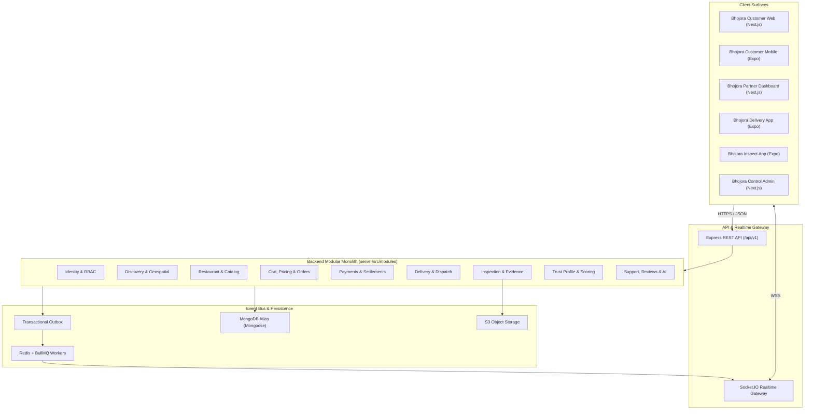
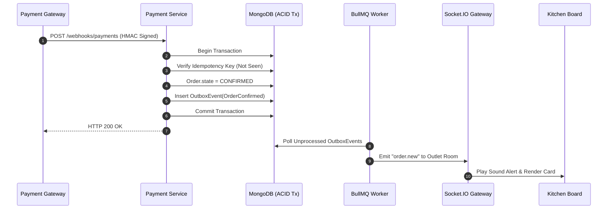
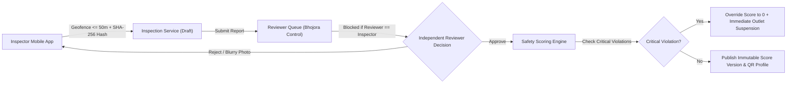

# BHOJORA — System Architecture & Domain Boundaries

This document defines the modular monolith architecture, module ownership boundaries, request/event pipelines, scaling paths, and data classification for **BHOJORA**.

---

## 1. Architectural Pattern: Modular Monolith

Per **ADR-001**, BHOJORA implements a **Modular Monolith** deployed as a cohesive Node.js/TypeScript backend (`server/`). Business capabilities are segregated into isolated domain modules (`server/src/modules/`). Cross-module queries and state changes strictly occur via exported domain service interfaces or asynchronous outbox domain events—never via direct database access across boundaries.



---

## 2. Backend Layering & Request Pipeline

Every HTTP call traverses a deterministic, strict pipeline:

```text
HTTP Request ➔ Request ID & Logging ➔ Rate Limiter ➔ JWT/Session Auth ➔ RBAC & Resource Guard ➔ Zod Payload Validation ➔ Controller (Transport Only) ➔ Domain Service (Business Logic) ➔ Repository (Mongoose) ➔ Standardized API Response
```

### Strict Responsibilities:
1. **Routes:** Map endpoints to middleware chains and controllers.
2. **Middleware:** Authentication, Role-Based Access Control (RBAC), outlet-level tenant verification, and Zod schema validation.
3. **Controllers:** Extract validated inputs, invoke Domain Service methods, format HTTP status codes. **Zero business logic permitted.**
4. **Domain Services:** Enforce all business invariants (integer paise calculations, critical hygiene overrides, state transitions).
5. **Repositories:** Own Mongoose models and database queries exclusively for their assigned domain.

---

## 3. Domain Ownership & Boundary Matrix

No two modules may write to the same MongoDB collection. Cross-domain read joins or writes use explicit Service Interfaces or Outbox Events.

| Module Directory | Owned Collections | Exported Public Service Interface | Domain Events Published |
| :--- | :--- | :--- | :--- |
| `identity` | `users`, `user_sessions`, `roles`, `permissions`, `consent_records` | `IdentityService` (Verify token, get user scope) | `UserRegistered`, `SessionRevoked` |
| `users` | `customer_profiles`, `addresses` | `CustomerService` (Validate delivery address zone) | `AddressUpdated` |
| `restaurants` | `restaurants`, `restaurant_outlets`, `restaurant_staff`, `restaurant_documents`, `outlet_hours` | `OutletService` (Check open status, serviceability) | `OutletOnboarded`, `OutletSuspended` |
| `catalog` | `menus`, `menu_categories`, `menu_items`, `item_customizations`, `inventory_records` | `CatalogService` (Fetch active menu, validate item prices) | `MenuItemUpdated`, `ItemOutOfStock` |
| `discovery` | *Read-Optimized Projections / Geo Indexes* | `DiscoveryService` (Geospatial search & filtering) | — (Consumes outlet/trust updates) |
| `cart` | `carts` | `CartService` (Single-outlet cart validation) | — |
| `pricing` | `pricing_quotes`, `coupons` | `PricingService` (Generate authoritative integer paise quote) | `CouponRedeemed` |
| `orders` | `orders`, `order_items`, `order_events`, `outbox_events` | `OrderService` (Order state machine transitions) | `OrderConfirmed`, `OrderReady`, `OrderDelivered`, `OrderCancelled` |
| `payments` | `payments`, `payment_events`, `refunds`, `settlements`, `reconciliation_records`, `idempotency_keys` | `PaymentService` (Provider order, refund trigger) | `PaymentCaptured`, `PaymentFailed`, `RefundProcessed` |
| `delivery` | `delivery_partners`, `delivery_assignments`, `delivery_location_events`, `delivery_incidents` | `DeliveryService` (Dispatch job, verify delivery OTP) | `PartnerAssigned`, `PartnerPickedUp`, `LocationPinged` |
| `inspections` | `inspectors`, `inspector_authorizations`, `inspection_assignments`, `inspections`, `checklist_templates`, `checklist_results`, `inspection_evidence`, `inspection_reviews` | `InspectionService` (Schedule audit, submit report, reviewer sign-off) | `InspectionSubmitted`, `InspectionApproved`, `CriticalViolationDetected` |
| `safety-profile`| `safety_scores`, `safety_events`, `corrective_actions`, `appeals` | `TrustProfileService` (Serve public safety profile & QR payload) | `SafetyScoreUpdated`, `CAPCreated` |
| `support` | `reviews`, `complaints`, `support_tickets`, `notifications` | `SupportService` (Ticket triage, verified review validation) | `SafetyComplaintEscalated`, `ReviewPublished` |
| `governance` | `audit_logs`, `feature_flags`, `policy_versions`, `integration_webhook_events` | `AuditService` (Immutable audit logging) | — |

---

## 4. Transactional Outbox & Asynchronous Flows



---

## 5. Trust Engine Flow & Governance Boundaries



---

## 6. Data Classification & Storage Boundaries (ADR-007)

| Tier | Classification | Examples | Storage & Access Rules |
| :--- | :--- | :--- | :--- |
| **Tier 1** | Public Data | Restaurant menus, outlet pins, published safety scores, audit dates | Unauthenticated GET; aggressive Redis/CDN caching |
| **Tier 2** | Operational Data | Order items, prep timers, dispatch coordinates, internal cleaning logs | Authenticated RBAC + Outlet/Zone scoping |
| **Tier 3** | Sensitive PII | Customer phone/address, rider KYC (Aadhar/DL), inspector personal info | Encrypted at rest; masked in logs; masked via virtual proxy numbers for calls |
| **Tier 4** | Restricted Secrets | Argon2id password hashes, JWT signing secrets, payment keys, bank info | Isolated secrets manager; strictly excluded from logs and error traces |

---

## 7. Failure & Circuit-Breaker Architecture

1. **Payment Aggregator Degradation:** Synchronous checkout creation utilizes a 5-second timeout; late payment statuses reconcile safely via asynchronous webhooks and polling.
2. **Maps API Outage:** Cached Kolkata H3 / Polygon service zones evaluate serviceability locally without requiring external geocoding uptime.
3. **Notification Failure:** Failed SMS/FCM dispatches retry via exponential backoff in BullMQ before landing in Dead Letter Queues (DLQ) for admin intervention.
4. **Offline Inspector Mitigation:** Inspection checklist drafts and cryptographic photo hashes persist securely in encrypted mobile SQLite storage until network connectivity restores.
