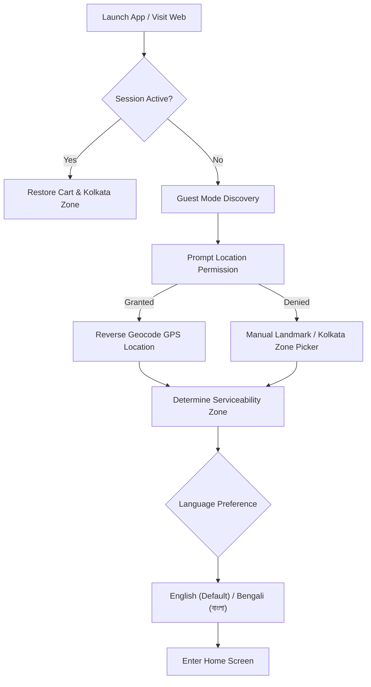
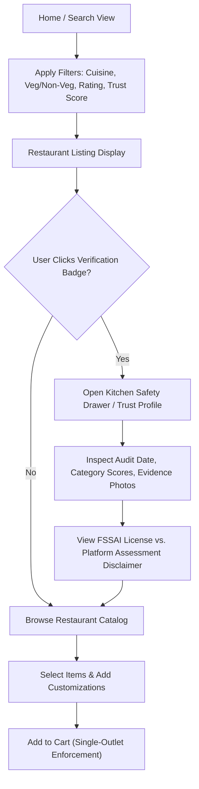
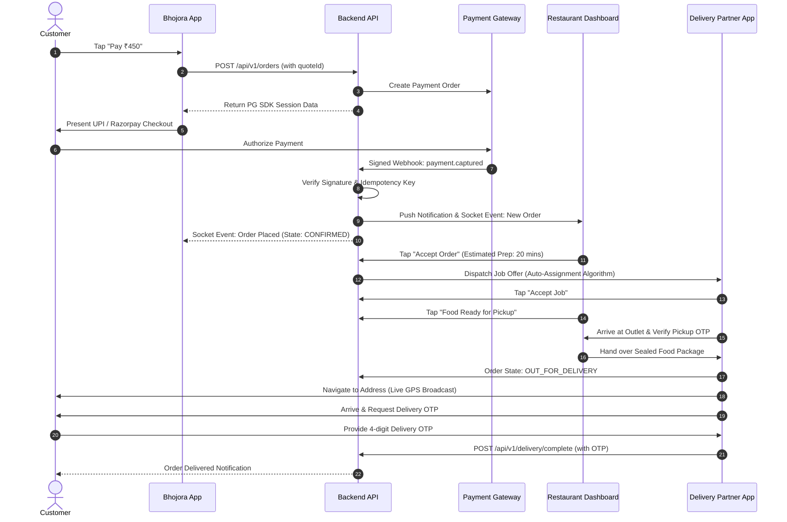
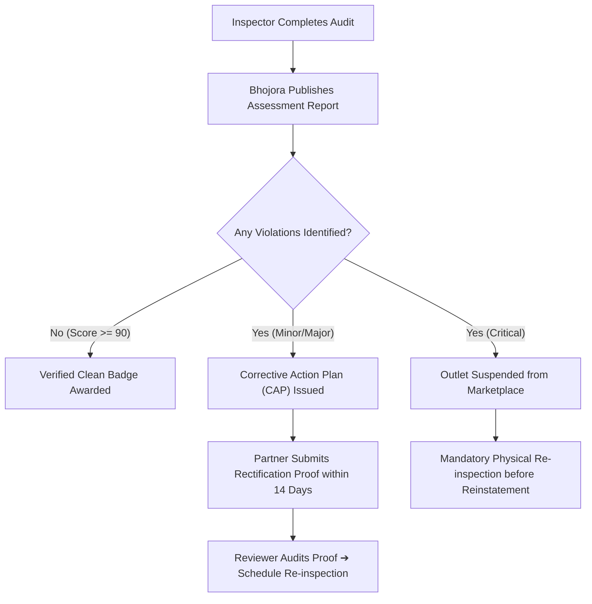

# BHOJORA — Comprehensive User Journey Specifications

This document defines the complete end-to-end user journeys for all personas across the BHOJORA food delivery and trust transparency ecosystem. Every journey captures triggers, touchpoints, decision nodes, happy paths, exceptions, edge cases, and accessibility considerations.

---

## Table of Personas & Surfaces

| Persona | Primary Interface | Secondary Interface | Core Focus |
| :--- | :--- | :--- | :--- |
| **1. Customer** | `client/customer-mobile` (Expo) | `client/customer-web` (Next.js) | Discovery, ordering, trust verification, live tracking |
| **2. Restaurant Partner** | `client/restaurant-web` (Next.js) | Mobile Web | Catalog, live order queue, hygiene compliance |
| **3. Delivery Partner** | `client/delivery-mobile` (Expo) | SMS / OTP fallback | Dispatch acceptance, navigation, proof of delivery |
| **4. Independent Inspector**| `client/inspector-mobile` (Expo)| — | On-site audits, evidence capture, score calculation |
| **5. Inspection Reviewer** | `client/admin-web` (Next.js) | — | Verification of reports, critical overrides, publishing |
| **6. Support & Ops Admin** | `client/admin-web` (Next.js) | — | Live dispatch oversight, dispute triage, refunds |

---

## 1. Customer Journeys (Bhojora Consumer)

### Journey C1: Onboarding, Location & Language Configuration

- **Pre-conditions:** App launched or website visited.
- **Trigger:** First-time user opens Bhojora or existing user switches locations.
- **Kolkata Specifics:**
  - Manual landmark selector includes Kolkata prominent zones: *Salt Lake (Bidhannagar), New Town, Park Street / Central, South Kolkata (Gariahat, Jadavpur, Tollygunge), North Kolkata (Shyambazar, Dum Dum), Howrah*.
  - Language toggle allows instant switching between English and Bengali (`বাংলা`) for UI labels, cuisine tags, and safety descriptions.
- **Edge Cases:**
  - *GPS outside service zones:* Display polite message explaining Bhojora is currently live in Kolkata, allowing manual browsing of Kolkata menus.
  - *Network disconnection:* Render offline cache of last known zone and popular dishes.

---

### Journey C2: Trust-First Restaurant & Dish Discovery

- **Happy Path:**
  1. Customer browses curated Kolkata carousels (e.g., "Verified Biryani Kitchens in Park Circus", "Hygienic Sweets in North Kolkata").
  2. Each restaurant card prominently renders two distinct badges:
     - **Customer Rating:** Yellow Star (e.g., `★ 4.4 (1.2k)`).
     - **Bhojora Trust Badge:** Distinct Trust Green Shield (e.g., `🛡️ Verified Clean — 94/100`).
  3. Clicking the Trust Badge opens the **Bhojora Trust Modal**, showing the exact inspection date, inspector findings, kitchen photos, and audit policy version.
  4. Customer adds dishes with variants (e.g., Chicken Chaap with choice of Rumali Roti).
- **Edge Cases:**
  - *Attempting to add items from two different outlets:* Modal warning: "Your cart contains items from [Restaurant A]. Replace cart items with [Restaurant B]?"
  - *Expired inspection:* Badge changes to neutral grey `Assessment Due for Renewal`, with an explainer that the 6-month validity window elapsed.

---

### Journey C3: Cart, Authoritative Pricing Quote & Checkout
- **Trigger:** Customer taps "View Cart".
- **Key Flow:**
  1. Frontend sends cart payload to `POST /api/v1/checkout/quote`.
  2. Server authoritatively computes:
     - Item base prices in integer paise.
     - Outlet packaging charges.
     - Delivery fee calculated based on road distance to customer address.
     - Platform fee.
     - Applicable GST (5% for standard restaurant services).
     - Validates promo code eligibility.
  3. Quote response contains an authoritative `quoteId` with a 10-minute expiry timestamp.
  4. Customer selects delivery address (e.g., "Flat 4B, Tower 2, Urbana, Anandapur, Kolkata - 700107").
  5. Customer selects payment method (UPI / Cards / Net Banking / COD if eligible).
- **Edge Cases:**
  - *Price changed while user was browsing:* Server rejects quote generation with code `ITEM_PRICE_CHANGED`; client refreshes UI with updated price highlighting the delta.
  - *Item becomes out of stock:* Quote service marks unavailable items; customer is prompted to remove or replace them.

---

### Journey C4: Payment Processing, Order Lifecycle & Live Tracking

---

### Journey C5: Feedback, Reviews & Food Safety Escalation
- **Customer Review Separation:**
  - Food Taste & Quality (1–5 Stars + tags like "Rich Flavor", "Authentic Spices").
  - Packaging & Temperature (1–5 Stars + "Spill-proof", "Hot").
  - Delivery Experience (1–5 Stars + "Polite Partner", "Fast").
- **Food Safety Complaint Flow:**
  - If a customer selects "Food Quality Issue" ➔ "Foreign object", "Undercooked", "Spoiled/Stale food", or "Suspected Food Poisoning":
  - Mandatory prompt for photo evidence and medical documentation (if applicable).
  - Explicit warning: *"Allegations are investigated independently by our Trust & Safety team. The restaurant will be notified for corrective action."*
  - Creation of a High-Severity Safety Ticket in `Bhojora Control`.

---

## 2. Restaurant Partner Journeys (Bhojora Partner)

### Journey R1: Onboarding, KYC & Outlet Configuration
1. Owner signs up with phone number + OTP and official business email.
2. Step 1: Legal Entity Details (GSTIN, PAN, FSSAI Registration/License number with expiry).
3. Step 2: Outlet Setup (Outlet Name, Exact Geocoded Map Pin, Full Postal Address, Ward / Borough in Kolkata).
4. Step 3: Operating Hours & Slots (e.g., Lunch: 12:00–16:00, Dinner: 19:00–23:30).
5. Step 4: Bank Account for automated NEFT/IMPS payouts.
6. Step 5: Submission for Admin Review.

### Journey R2: Catalog & Real-Time Menu Management
- **Catalog Structure:**
  - Categories (e.g., Starters, Biryani & Rice, Mughlai Curries, Desserts).
  - Menu Items with high-resolution imagery, description, dietary indicators (`PURE_VEG`, `NON_VEG`, `EGG`), declared allergens (Nuts, Dairy, Gluten), and integer paise pricing.
  - Item customizer: Add-on groups (e.g., "Choose Portion: Half / Full", "Add Extra Boiled Egg: ₹20").
- **Quick-Toggle Operations:**
  - Single-click "Out of Stock for Today" vs. "Permanently Inactive".
  - Turnaround time adjustment (e.g., "Busy kitchen: add +15 mins prep time").

### Journey R3: Live Kitchen Prep Board
- Visual Kanban columns: `Incoming` ➔ `In Preparation` ➔ `Ready for Handover` ➔ `Handed Over`.
- Audio chime alert for incoming orders.
- Detailed order receipt print capability (3-inch thermal printer support).
- Out-of-stock item substitution: Partner can initiate a customer call/SMS via platform proxy if an item runs out.

### Journey R4: Inspection Compliance & Corrective Action

---

## 3. Delivery Partner Journeys (Bhojora Delivery)

### Journey D1: Daily Login, Shift Start & Zone Allocation
1. Partner opens `Bhojora Delivery` app.
2. Daily selfie check / verification (to prevent account sharing).
3. Toggle "Go Online" in assigned home zone (e.g., "Bidhannagar / Salt Lake").
4. Real-time battery and network status check.

### Journey D2: Job Offer, Pickup & Drop Execution
1. Audio alert accompanies incoming job modal:
   - Pickup: "Arsalan, Park Circus" (Distance: 1.2 km).
   - Drop: "Beckbagan Row" (Distance: 2.1 km).
   - Estimated Earnings: `₹65.00`.
   - Countdown timer: 45 seconds to Accept or Decline.
2. Upon Accept: Turn-by-turn map guidance to restaurant.
3. Upon arrival at restaurant: Tap "Arrived at Outlet".
4. Collect order: Verify Order ID and item count. Confirm handover.
5. Navigate to Customer Address. Turn-by-turn routing with masked call button.
6. Customer Handover: Request 4-digit OTP provided in customer app. Enter OTP to mark delivery complete.
7. Earnings credited instantly to Partner In-App Ledger.

---

## 4. Independent Inspector Journeys (Bhojora Inspect)

### Journey I1: Assignment & Geofenced On-Site Check-in
1. System dispatches scheduled inspection assignment (no self-selection to prevent collusion).
2. Inspector reviews outlet address and historical inspection reports.
3. Inspector arrives at restaurant premises.
4. App verifies inspector location is within **50 meters** of outlet geocoordinates before enabling the checklist.
5. Inspector signs in with the Restaurant Manager on duty.

### Journey I2: Structured Evidence-Backed Audit Execution
The inspector completes the standardized 6-category checklist:
1. **Food Storage & Temperature Control (25% weight):**
   - Cold storage temperature logs (Refrigerators ≤ 4°C, Freezers ≤ -18°C).
   - Separation of raw meats and ready-to-eat items.
   - Mandatory photo evidence of temperature probe.
2. **Personal Hygiene & Food Handling (20% weight):**
   - Hairnets, clean aprons, trimmed nails, glove usage.
   - Handwashing stations equipped with soap and running water.
3. **Cleaning, Sanitation & Pest Control (25% weight):**
   - Pest control contract validity and absence of rodent/cockroach droppings.
   - Cleanliness of food contact surfaces and grease traps.
   - *CRITICAL VIOLATION CHECK:* Active rodent or cockroach infestation in prep area immediately flags a `CRITICAL_FAIL`.
4. **Water & Raw Material Quality (15% weight):**
   - Potable water filtration system maintenance record.
   - FSSAI-compliant branded ingredients; absence of expired stock.
5. **Waste Management & Drainage (10% weight):**
   - Segregated foot-operated wet and dry waste bins.
   - Grease traps cleared and free from stagnation.
6. **Statutory Compliance & Records (5% weight):**
   - FSSAI license displayed prominently on wall.
   - Food handler medical fitness certificates on file.

### Journey I3: Tamper-Evident Evidence & Submission
- Every photo captured within the app is stamped with:
  - Exact UTC timestamp and Asia/Kolkata local time.
  - GPS latitude, longitude, and accuracy radius.
  - SHA-256 cryptographic hash calculated on device.
- Review and summary generated.
- Inspector and Restaurant Manager sign digitally on screen.
- Inspector submits report to the **Independent Review Queue**.
- *System Constraint:* Inspector cannot publish or approve their own report.

---

## 5. Reviewer & Admin Governance Journeys (Bhojora Control)

### Journey A1: Independent Inspection Verification
1. Independent Reviewer logs into `client/admin-web` with MFA.
2. Opens "Pending Inspection Reviews" queue.
3. Inspects submitted report against photo hashes and GPS boundaries.
4. Evaluates findings:
   - If acceptable: Approves report. The system calculates the final immutable safety score and publishes the public Trust Profile.
   - If findings indicate a critical violation: System immediately updates outlet status to `SUSPENDED` and triggers an urgent operational notice.
   - If evidence is blurry or incomplete: Rejects report back to inspector for re-visit.

### Journey A2: Marketplace Operations & Fraud Triage
- Real-time Kolkata dispatch monitor: Visual map showing active delivery riders, pending orders, and hot-spots.
- Manual intervention tools:
  - Reassign stuck delivery orders.
  - Cancel and trigger instant refund for delayed or damaged items with audit reason recording.
  - Reconcile daily payment gateway capture batches against bank settlements.

---

## 6. Edge Cases & Exception Matrix

| Persona | Scenario | System Handling |
| :--- | :--- | :--- |
| **Customer** | Price changes while item in cart | Server recalculates quote; flags price discrepancy before payment; requires customer consent. |
| **Customer** | Webhook arrives after browser redirect timeout | Order state machine reconciles asynchronously via webhook; notifies customer via push/SMS. |
| **Restaurant**| Out of stock during active preparation | Restaurant can request customer call via proxy or cancel specific item with automated partial refund. |
| **Delivery** | Customer unreachable at delivery location | Partner triggers "Customer Not Available" countdown (8 minutes); platform calls customer; if unfulfilled, return workflow initiated. |
| **Inspector** | Inspector loses internet in kitchen basement | Offline-first draft storage in SQLite/Encrypted device storage; syncs automatically upon regaining signal. |
| **Platform** | Severe weather (Kolkata monsoon / waterlogging) | Geofenced surge pricing or temporary zone shutdown with banner alert across customer surfaces. |
